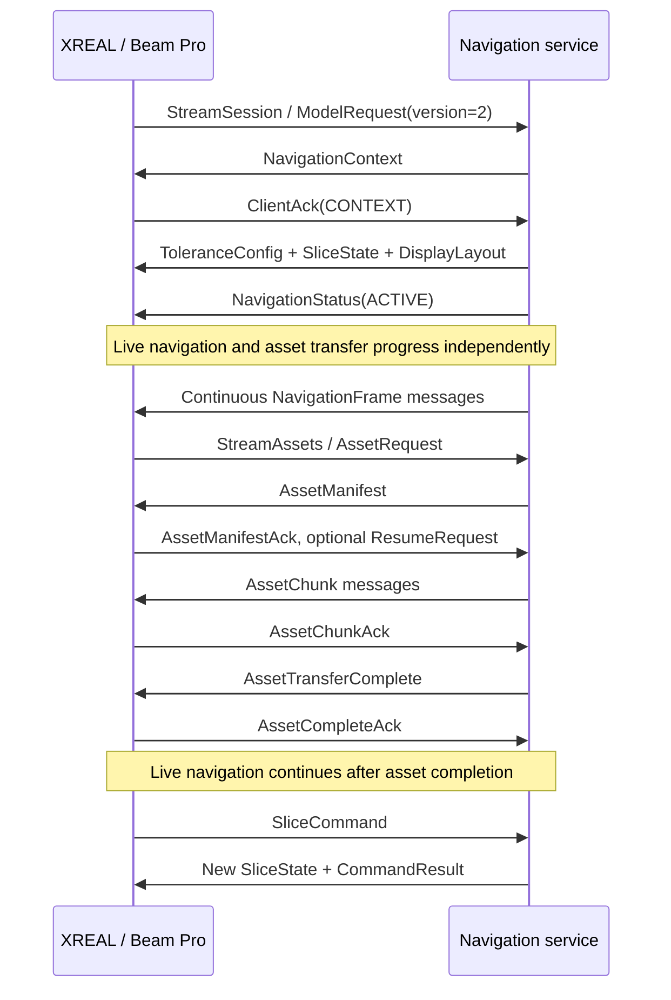

# XREAL Integration Guide for Surgical Robot Navigation Software

Date: 2026-09-18

Audience: developers of surgical robot navigation software, communication services, imaging, and system integration

Basis: protocol and client source in the First XR workspace at the time of this review

**The navigation system must implement a gRPC service that sends its computed live metrics, case/plan context, complete DICOM, and STL to the XREAL client on Beam Pro, while receiving glasses slice operations, control results, and optional observation video. The navigation system is the authoritative source of data and control state.**

This document distinguishes **existing implementation**, verified in the protocol or source; **development requirements**, behaviors the navigation system should implement; and **recommendations/to be confirmed**, items not yet jointly verified. Source and simulator checks do not establish validation with a real robot, Beam Pro, or clinical use. This is a dated integration record; for subsequent changes such as the RGB pause policy and current connection defaults, consult the current [README](../README.md) and source.

Provide this file together with the same version of [dental_model_transfer.proto](../dental_model_transfer.proto) at handoff. That file is authoritative for field names, numbers, types, and enums; do not create a conflicting message definition. Protocol SHA-256 checked in this review:

```text
527cf36ab17bebca9fe897e46c3e18e4c46fd93924b870f59d396f67c52cfeea
```

## 1. Responsibilities

| Capability | Navigation-system responsibility | Current XREAL / Beam Pro responsibility |
|---|---|---|
| Case and plan | Select case, CT, tooth, plan, drill, step, and versions | Display the current context and filter old versions |
| Live navigation | Calculate drill tip/axis, deviation, angle, and depth; determine tracking validity | Display values, directions, colors, and data freshness |
| Coordinates and registration | Unify navigation, DICOM, and model spaces; provide transforms | Sample and display using supplied coordinates and transforms |
| Tolerances | Provide project-approved thresholds, boundary rules, and hysteresis | Apply received configuration; show "Thresholds not synced" when missing |
| CT and models | Supply complete DICOM series, teeth/drill STL, manifests, and checksums | Receive, verify, construct volumes, slice, and render models |
| Slice synchronization | Maintain synchronization switch and slice states for both displays; arbitrate conflicts | Send slice requests and apply the returned authoritative state |
| Display control | Control HUD/model positions, visibility, and reset | Apply layouts and report actual results |
| Remote observation | Request XR mirror/RGB on demand; receive and decode media | Encode real XR left-eye imagery and optional RGB |

The protocol contains no robot-arm motion, velocity, torque, or drill start/stop commands. Glasses slice gestures belong only to display control; do not connect them to robot motion control. The current 3D model window is a separate observation window, not an AR overlay already registered to real teeth.

## 2. Connection and Service Interfaces

### 2.1 Service Deployment

- **The navigation workstation is the gRPC Server; Beam Pro is the gRPC Client**, initiating the connection.
- The default address at this review was `192.168.31.166:50051`, with `device_id=beam-pro` and initial requested `dataset_id=default`. The address is editable on Beam Pro's Connection page. Production must maintain explicit device-to-case binding; `default` must not map indiscriminately to arbitrary patient data.
- The client uses cleartext HTTP/2 gRPC at `http://IP:port`, without certificate, Token, or device-authentication exchange. Configure development integration accordingly; deployments requiring TLS/device authentication need coordinated changes on both ends. Server-only changes would prevent the existing client from connecting.
- Bind the gRPC server to an interface reachable from Beam Pro and allow the relevant TCP port. Allow the agreed UDP port separately for video; the current receiver example uses `5555`.
- The two streams below are independent RPCs sharing one gRPC channel in the current client. Independent application streams do not imply dedicated network bandwidth.

```proto
package dentalmodeltransfer;

service DentalModelTransfer {
  rpc StreamDentalModel(stream ClientMessage) returns (stream ServerMessage) {}
  rpc StreamSession(stream ClientMessage) returns (stream ServerMessage) {}
  rpc StreamAssets(stream AssetClientMessage) returns (stream AssetServerMessage) {}
}
```

Only interface signatures are shown here. Generate code from the complete original `.proto`.

| RPC | Development requirement | End condition |
|---|---|---|
| `StreamSession` | Required: navigation, tolerances, slices, layout, observation control, and feedback | `SessionEnd` or transport disconnection |
| `StreamAssets` | Required for complete CT/model functionality: manifests, chunks, resume, and verification | May remain open for requests from later contexts |
| `StreamDentalModel` | Legacy client/service compatibility only | Not the delivery entry point for the complete functionality described here |

The current client falls back to v1 only when `StreamSession` returns gRPC `UNIMPLEMENTED`. If only the asset RPC returns `UNIMPLEMENTED`, navigation continues without v2 asset capability.

Bidirectional gRPC streams allow independent reads/writes and preserve message order within each stream. Different RPCs still need business IDs and versions for correlation. The server should read and send concurrently, not wait for the client to close the request stream before replying. [Official gRPC explanation](https://grpc.io/docs/what-is-grpc/core-concepts/)

### 2.2 Message Exchange Overview

| Direction | Message | Trigger |
|---|---|---|
| XREAL → navigation | `ModelRequest` | Session establishment, protocol version 2 |
| Navigation → XREAL | `NavigationContext` | Initial connection, context change, necessary idempotent resend |
| Navigation → XREAL | `ToleranceConfig` | Context initialization or tolerance update |
| Navigation → XREAL | `NavigationFrame` | Continuous live sending; start with the existing simulator's 30 Hz as a recommendation |
| Navigation → XREAL | `NavigationStatus` | Navigation start, pause, stop |
| Navigation → XREAL | `SliceState` | Initialization, synchronization changes, slice changes, navigation-system takeover |
| XREAL → navigation | `SliceCommand` | Gesture or client slice operation |
| Navigation → XREAL | `CommandResult` | Acceptance/rejection and reason for each slice command |
| Navigation → XREAL | `DisplayLayout` / `ObservationControl` | Operator changes display or starts/stops observation |
| XREAL → navigation | `ClientAck` / `DisplayStateReport` / `ObservationStatus` | Control acknowledgement, actual layout, media-source runtime state |
| Both | `Heartbeat` | Application-level keepalive initiated by navigation and answered by the client |
| XREAL → navigation | `AssetRequest` / asset ACKs / `AssetResumeRequest` | Requests and feedback on the independent asset stream |
| Navigation → XREAL | `AssetManifest` / `AssetChunk` / `AssetTransferComplete` | Transfer on the independent asset stream |
| Navigation → XREAL | `SessionEnd` | Explicitly ends the corresponding session/asset stream |
| XREAL → navigation | RTP video | Sent on demand after valid observation control, outside gRPC messages |

## 3. Initial Connection and State Changes

### 3.1 Recommended Initialization Order



**Actual concurrency:** the client may establish the asset RPC before receiving context, then wait. It sends `AssetRequest` only after accepting `NavigationContext`. The server must not block session initialization because the asset stream has no initial request yet, or assume a fixed arrival order for the two RPCs.

Waiting for successful context ACK before starting the full context send flow is recommended. However, the server may observe an asset request before the context ACK, so independently validate `session_id/dataset_id/context_version` rather than mechanically requiring ACK first. Navigation metrics can be integrated before CT; CT readiness must not be a prerequisite for sending live frames.

Initial request example. All `textproto` blocks below are examples of message content, not another network encoding:

```textproto
# type: dentalmodeltransfer.ClientMessage
request {
  device_id: "beam-pro"
  dataset_id: "default"
  protocol_version: 2
  client_session_id: "client-connection-001"
  requested_capabilities: CAPABILITY_NAVIGATION_V2
  requested_capabilities: CAPABILITY_DICOM_ASSETS
  requested_capabilities: CAPABILITY_SLICE_CONTROL
  requested_capabilities: CAPABILITY_DISPLAY_LAYOUT
  requested_capabilities: CAPABILITY_XR_MIRROR
  requested_capabilities: CAPABILITY_RGB_VIEW
}
```

`requested_capabilities` is a requested feature set, not proof that the camera, encoder, or real CT is available. The protocol has no separate server-capability negotiation response; do not invent messages such as `HelloAck` that the current client cannot recognize.

### 3.2 ID and Version Rules

| Field | Navigation-system maintenance rule |
|---|---|
| `session_id` | Server logical session identifier; use a new ID after restart if version state cannot be restored |
| `client_session_id` | Client connection identifier for logs and command deduplication; does not replace the server session ID |
| `case_id` | Case identifier; prefer a business ID without names or other display-irrelevant information |
| `dataset_id` | Asset-set identifier; must agree across context, manifest, and descriptors |
| `ct_id` | Selected CT volume identifier, matching `SlicePlane.volume_id` |
| `plan_id/tooth_id/tool_id/step_id` | Current plan, tooth, drill, and step; updating only the workstation UI is insufficient |
| `context_version` | Nonzero and monotonically increasing within a session; increment for case, CT, plan, tooth, drill, step, or registration-transform changes |
| `NavigationFrame.sequence` | Strictly increasing within `session_id/context_version`; gaps allowed, repeats or decreases rejected |
| `ToleranceConfig.config_version` | Nonzero and monotonically increasing within the current context |
| Each `control_version` | Separate nonzero increasing counters for slice, layout, and observation controls; do not mix them into one counter |
| `command_sequence` | Client command correlation number for idempotent deduplication and matching `CommandResult` |
| `transfer_id` | Identity of one immutable asset manifest; never change content, size, or checksums under the same ID |

When switching context, stop delivering old frames and clear the pending old-frame slot on the server, increment the context version, send the new `NavigationContext`, resend tolerances, slices, layout, and any observation control that should remain active, then send new-version frames. The current client clears old dynamic frames, tolerances, and these control states.

When reconnecting to the same session/context, frame sequences must continue; the client may remember the last consumed sequence. If the sequence cannot be restored, create a new logical session rather than restarting at `sequence=1` under the old session.

Identical content may be resent idempotently with the same version; changed content at the same version is rejected. A new registration matrix also requires a context increment. There is no independent `registration_version` in the protocol; maintain it internally on the navigation side and associate it with `context_version`.

### 3.3 ACK Limits

- `ClientAck.kind` identifies context, tolerance, slice, layout, observation control, or session end; `version` refers to that object's version. Live navigation frames have no per-frame ACK.
- `ClientAck` has no separate `context_version`. Correlate through the connection, sent-message records, and `kind/item_id/version`; do not mistake old control ACKs for success in a new context.
- Context ACK `item_id` is `plan_id`; tolerance uses `tolerance`, slice uses `volume_id`, layout uses `display_layout`, and observation uses `observation_control`.
- While CT is not ready, a slice ACK may have `accepted=true` and report that it is waiting for CT. This does not prove that the glasses rendered the slice.
- Command ACK, complete-asset ACK, media-source availability, and successful video decoding on the navigation system are distinct completion conditions and must be recorded separately.

## 4. Coordinates, Directions, and Metric Calculation

### 4.1 Fixed Conventions

| Data | Convention |
|---|---|
| All navigation positions, deviations, and depths | Millimeters; explicitly set `DISTANCE_UNIT_MILLIMETER` |
| All angles and angular components | Degrees; explicitly set `ANGLE_UNIT_DEGREE` |
| HUD / model window positions | **Meters**, through `hud_position_m/model_position_m`; the layout-unit exception |
| `plan_axis` | Unit vector from planned entry toward planned target |
| `drill_axis` | Unit vector from drill tail toward tip |
| `buccal_axis/mesial_axis` | Current tooth's Buccal/Mesial directions in navigation space, independent of clinician head pose |
| Position and tilt signs | `+buccal/-lingual`, `+mesial/-distal` |
| Fixed HUD directions | Buccal top, Lingual bottom, Mesial left, Distal right (compact English markers: B/L/M/D) |
| 4×4 matrices | Exactly 16 doubles, flattened by rows; translation at indices 3, 7, 11, in mm |

The navigation system must first transform tracker, robot-arm, tool-calibration, and planning data into one navigation space. Do not directly subtract a CT-space planned entry from a robot-base-space drill tip.

The mathematical meaning of `patient_from_dicom` is:

```text
p_navigation = patient_from_dicom × [p_dicom.x, p_dicom.y, p_dicom.z, 1]^T
```

Explicitly sending an identity matrix is recommended even when the spaces coincide. `coordinate_frame_id` should be stable and unambiguous; the corresponding `FrameOfReferenceUID` can be used when directly using the DICOM Patient coordinate system. Interpret DICOM Patient coordinates and row/column directions according to the standard; pixel row/column indices are not coordinates in mm. [DICOM Image Plane Module](https://dicom.nema.org/medical/dicom/current/output/chtml/part03/sect_C.7.6.2.html)

**Pay particular attention to `drill_from_teeth`:** this historical name can be opposite to the usual "target from source" convention. `DentalRobotModelRenderer` currently uses its fourth column directly as the drill position in teeth space, and its third/second columns as drill orientation. To integrate with this client, send the transform from **drill-model local coordinates → teeth/navigation display coordinates**, mathematically `teeth_from_drill`. If the navigation system's identically named variable represents the inverse, invert it first.

Model integration also requires STL vertices in mm, teeth aligned with navigation space, and explicitly defined local axes/origin for the tool STL. The protocol has no separate `patient_from_teeth`; transform teeth from any other modeling space during export/adaptation. **The matrix translation column equals `drill_tip_mm` only if the tool-model origin is the drill tip.** Otherwise, use the tip's local offset from tool calibration.

Do not multiply the matrix by 0.001 to "convert everything to meters." Current validation rejects scaling, shear, NaN/Infinity, and nonhomogeneous matrices. Orthogonal reflections can pass current state validation, but model orientation across left/right-handed coordinate systems still requires explicit comparison samples; validation success does not establish correct rendering orientation.

### 4.2 Metric Definitions

The following adaptation formulas match current field meanings. If authoritative navigation algorithms already exist, verify their geometry before converting; do not simply rename fields and reuse differently defined values.

Let `P` be the planned entry, `a` the unit axis from entry to target, `T` the current drill tip, and `d` the unit drill axis from tail to tip. Let `b/m` be mutually orthogonal Buccal/Mesial unit axes within the slice plane:

```text
v = T - P
current_depth_mm   = dot(v, a)
remaining_depth_mm = target_depth_mm - current_depth_mm
e = v - dot(v, a) * a
lateral_buccal_mm  = dot(e, b)
lateral_mesial_mm  = dot(e, m)
lateral_mm        = sqrt(lateral_buccal_mm^2 + lateral_mesial_mm^2)
angle_deg         = acos(clamp(dot(d, a), -1, 1)) * 180 / pi
```

`current_depth_mm < 0` can indicate that the tip has not reached entry; `remaining_depth_mm < 0` indicates over-depth. Preserve both signs. Lateral deviation here means **drill-tip distance from the planned axis**. If the existing algorithm uses deviation of a drill-axis/slice intersection, agree on a conversion rather than mixing definitions.

**Angular components need separate alignment:** the client requires `sqrt(tilt_buccal_deg² + tilt_mesial_deg²)` to approximately equal `angle_deg`. Two independently projected `atan2` angles generally do not satisfy this relation exactly.

The recommended adapter distributes total tilt by tangential direction; confirm this during initial coordinate integration:

```text
q = d - dot(d, a) * a
if angle_deg ≈ 0: both tilt components are 0
otherwise u = q / length(q)
tilt_buccal_deg = angle_deg * dot(u, b)
tilt_mesial_deg = angle_deg * dot(u, m)
```

If the drill axis opposes the planned axis and tilt direction is undefined, do not fabricate a direction: send invalid state and a reason. Buccal/Mesial axes must preserve their actual anatomical meaning; do not reverse their names merely to pass validation.

### 4.3 Current Client Validation

| Check | Current behavior / requirement |
|---|---|
| Session and context | Must match the current context; old frames rejected |
| Sequence | Must exceed the last received sequence, including for `valid=false` frames |
| Values | Relevant scalars/vectors must be finite; total deviation, total angle, and target depth nonnegative; drill axis nonzero |
| Direction-presence flags | Complete HUD requires `has_lateral_direction`, `has_tilt_direction`, and `has_depth_breakdown` all true; set them only when the data has actually been calculated |
| Components and magnitudes | Position/angle differences must not exceed `max(0.02, magnitude × 5%)`, in mm / ° respectively |
| Depth equation | With depth breakdown, `remaining = target - current` may differ by at most 0.05 mm |
| Target depth | Frame target depth may differ from context target depth by at most 0.05 mm |
| Matrix | If provided, exactly 16 entries, passing homogeneous, finite, and orthogonal checks |
| Data time | Valid UTC Unix milliseconds; timestamps before 2000-01-01 or more than five seconds ahead of the receiving device's clock are rejected |

These are **current software consistency-check parameters**, not surgical accuracy, clinical acceptance values, or recommended navigation error limits.

## 5. Context, Tolerances, and Live Frames

### 5.1 Context Example

These synthetic test coordinates simplify validation and do not represent a real tooth. Replace identity fields with actual business IDs during integration; DICOM coordinate mapping must match the exported files.

```textproto
# type: dentalmodeltransfer.ServerMessage
navigation_context {
  session_id: "nav-session-001"
  case_id: "TEST-CASE-001"
  dataset_id: "test-dataset-001"
  ct_id: "test-ct-001"
  plan_id: "test-plan-001"
  tooth_id: "36"
  tool_id: "test-drill-001"
  step_id: "test-step-001"
  context_version: 1
  plan_entry_mm { x: 0 y: 0 z: 0 }
  plan_axis { x: 0 y: 0 z: 1 }
  target_depth_mm: 10
  buccal_axis { x: 0 y: 1 z: 0 }
  mesial_axis { x: -1 y: 0 z: 0 }
  coordinate_frame_id: "test-navigation-frame"
  patient_from_dicom: [1, 0, 0, 0, 0, 1, 0, 0, 0, 0, 1, 0, 0, 0, 0, 1]
  distance_unit: DISTANCE_UNIT_MILLIMETER
  angle_unit: ANGLE_UNIT_DEGREE
}
```

### 5.2 Tolerance Configuration

The navigation system must send all of these field groups, not just green/red values without boundaries and hysteresis:

| Type | Fields |
|---|---|
| Position | `lateral_green_max_mm`, `lateral_red_min_mm`, `lateral_hysteresis_mm` |
| Angle | `angle_green_max_deg`, `angle_red_min_deg`, `angle_hysteresis_deg` |
| Depth | `depth_approach_mm`, `depth_at_target_tolerance_mm`, `depth_overrun_red_mm`, `depth_hysteresis_mm` |
| Association | `session_id`, `context_version`, `config_version`, `boundary_rule`, distance/angle units |

Values must be finite and nonnegative. For both position and angle, `red_min >= green_max`; hysteresis must not exceed either `green_max` or `red_min-green_max`. Depth hysteresis must not exceed the approach distance or red over-depth threshold. All versions start at positive integers.

For initial classification with inclusive upper bounds: `value <= green_max` is green, `green_max < value <= red_min` amber, and `value > red_min` red. Exclusive bounds assign equality to the higher grade. Hysteresis also applies during operation, so color cannot be determined solely from the displayed one-decimal value.

```textproto
# type: dentalmodeltransfer.ServerMessage
# Synthetic integration data only; never use as clinical defaults.
tolerance_config {
  session_id: "nav-session-001"
  context_version: 1
  config_version: 1
  lateral_green_max_mm: 0.5
  lateral_red_min_mm: 1.0
  lateral_hysteresis_mm: 0.05
  angle_green_max_deg: 2.0
  angle_red_min_deg: 5.0
  angle_hysteresis_deg: 0.2
  depth_approach_mm: 1.0
  depth_at_target_tolerance_mm: 0.2
  depth_overrun_red_mm: 0.5
  depth_hysteresis_mm: 0.1
  boundary_rule: THRESHOLD_BOUNDARY_RULE_UPPER_BOUNDS_INCLUSIVE
  distance_unit: DISTANCE_UNIT_MILLIMETER
  angle_unit: ANGLE_UNIT_DEGREE
}
```

After rejection, send corrected content with a higher `config_version`; do not assume changed content can overwrite the same version. Actual thresholds must come from the project's applicable configurations and review process; this guide does not select them for the project.

### 5.3 Live Frame Example

**The timestamp below is only a placeholder. Send the actual acquisition time; never send a fixed timestamp or use resend time to disguise an old sample as a new one.** This example has 0.3 mm Buccal and 0.4 mm Mesial deviation, total 0.5 mm; 2° Buccal tilt; current depth 4 mm and remaining depth 6 mm. The model example assumes its origin is at the drill tip and local +Z points toward the tip.

```textproto
# type: dentalmodeltransfer.ServerMessage
navigation_frame {
  session_id: "nav-session-001"
  context_version: 1
  sequence: 1
  capture_time_unix_ms: 1789689600000
  valid: true
  drill_tip_mm { x: -0.4 y: 0.3 z: 4 }
  drill_axis { x: 0 y: 0.0348994967 z: 0.9993908270 }
  drill_from_teeth: [1, 0, 0, -0.4, 0, 0.9993908270, 0.0348994967, 0.3, 0, -0.0348994967, 0.9993908270, 4, 0, 0, 0, 1]
  lateral_mm: 0.5
  lateral_buccal_mm: 0.3
  lateral_mesial_mm: 0.4
  angle_deg: 2
  tilt_buccal_deg: 2
  tilt_mesial_deg: 0
  current_depth_mm: 4
  target_depth_mm: 10
  remaining_depth_mm: 6
  distance_unit: DISTANCE_UNIT_MILLIMETER
  angle_unit: ANGLE_UNIT_DEGREE
  has_lateral_direction: true
  has_tilt_direction: true
  has_depth_breakdown: true
}
```

### 5.4 Freshness, Stop, and Reconnection

Client data age = `max(0, receiving device UTC - capture_time_unix_ms)` + monotonic elapsed time after reception. Clock offset therefore directly affects delay/interruption display. Synchronize clocks and record the offset before integration testing; a target below 50 ms is recommended, subject to measured confirmation.

| Condition | Current display behavior |
|---|---|
| Data age ≤200 ms and other conditions satisfied | Normal live display |
| Data age >200 ms and ≤500 ms | Removes valid colors and warns of navigation delay |
| Data age >500 ms | Hides dynamic values and markers, reports interruption |
| `valid=false` | Removes dynamic content and shows the invalid reason |
| `NavigationStatus=PAUSED/STOPPED` or session disconnection | Clears dynamic navigation data; static CT may remain |

On tracking loss, invalid tools, or invalid registration, immediately send a new invalid frame with a clear reason; do not rely on silent timeout. On pause/stop, also stop sending `valid=true` frames: the current client's status notification clears data but does not permanently lock out subsequent valid frames.

Use a bounded latest-frame slot on the navigation system: new samples replace unsent old samples, preventing historical trajectories from replaying after transport recovers. Context/control messages use a reliable bounded queue, with one serialized writer per RPC. Asset reads, compressed-format conversion, and video decoding must not occupy the navigation sampling thread.

The client times out a session stream after 30 consecutive seconds without any server message. Send an application-level `Heartbeat` every five seconds as a recommendation; the client answers once. Do not immediately echo the answer again and create a loop. Heartbeats show communication activity but do not refresh navigation data age. Automatic reconnection defaults to an approximately five-second search interval, affected by UI/Inspector configuration.

`SessionEnd.reconnect_allowed=false` ends the current session and stops automatic reconnection; a manual connection can restart it. `SessionEnd` within the asset RPC affects only that stream. Neither `TransferEnd` nor `AssetTransferComplete` ends navigation.

## 6. Complete DICOM and STL Asset Transfer

### 6.1 Input Preparation

**Send the entire selected CT series and all its instances/frames, not only a current-slice screenshot, windowed images, or a voxel array stripped of geometry.** DICOM assets in one set form a single volume; do not mix localizers, Series, Frames of Reference, or reconstruction series.

The client currently declares only DICOM Transfer Syntax `1.2.840.10008.1.2.1` (uncompressed Explicit VR Little Endian). Convert other source formats on the navigation side to a format actually supported by the client. Compute length and SHA-256 over **the transmitted converted file itself**, not the original file.

The managed parser supports Part 10 files, 8/16-bit integer pixels, single-channel `MONOCHROME1/2`, pixel signedness, Bits Stored/High Bit, Rescale Slope/Intercept, window information, and patient-space geometry. Ordinary multiframe files are interpreted with consistent orientation and slice spacing; this does not imply arbitrary Enhanced CT or per-frame-varying geometry support. Native DCMTK bridge source and an adapter exist, but `libdental_dcmtk.so` was not found in the project during this review; do not assume native decoding is active on the device.

At minimum verify `SOPInstanceUID`, `SeriesInstanceUID`, `FrameOfReferenceUID`, `ImagePositionPatient`, `ImageOrientationPatient`, `PixelSpacing`, pixel rows/columns/bit depth/signedness, and slice positions. Slice order comes from spatial position, not filenames. DICOM pixel spacing is ordered row spacing, then column spacing; implement direction/pixel-coordinate transforms according to the standard. [DICOM geometry definitions](https://dicom.nema.org/medical/dicom/current/output/chtml/part03/sect_C.7.6.2.html)

STL types are limited to teeth `ASSET_TYPE_STL_TEETH` and drill `ASSET_TYPE_STL_DRILL`, at most one of each per manifest. Format and units must also follow section 4.

### 6.2 Manifest Fields and Limits

After accepting context, the client sends `AssetRequest` with `device_id/session_id/dataset_id/context_version`, `include_all=true`, and accepted transfer syntaxes. Return an `AssetManifest` matching that context.

| `AssetDescriptor` field | Requirement |
|---|---|
| `asset_id` | Nonempty, unique within the manifest, stable for resume |
| `dataset_id` | Matches manifest and current context |
| `asset_type` | DICOM instance, teeth STL, or drill STL |
| `relative_path/filename` | Safe relative name; do not send workstation absolute paths |
| `total_bytes` | Positive integer, actual transmitted file size |
| `sha256` | **32 raw digest bytes**, not a 64-character hexadecimal string |
| `media_type` | `application/dicom` for DICOM; `model/stl` may be used for STL |
| `transfer_syntax_uid` | DICOM requires a supported UID matching the file contents |
| `sop_instance_uid` | Required for DICOM, unique within manifest, matching the actual file |
| `frame_count` | Positive for DICOM and equal to decoded frame count; use 1 for a single-frame file |
| `order_index` | Unique, stable DICOM order number within the manifest; does not replace patient-space geometry |

Current hard receive limits: 8192 manifest entries, 512 MiB per DICOM file, 128 MiB per STL type, 16 GiB total assets, and 4 MiB per chunk. **These are rejection limits, not device capacity guarantees.** CT decoding and STL processing require additional memory.

For initial integration, use **256 KiB chunks**, matching the simulator. Do not fill chunks directly to 4 MiB: serialized messages add overhead, and both sides must confirm gRPC receive-message limits.

### 6.3 Sending State Machine

1. Receive `AssetRequest`, validate device binding/current context, and prepare an immutable asset snapshot.
2. Send `AssetManifest` and wait for `AssetManifestAck`. Stop and record the reason if rejected; do not blindly continue sending chunks.
3. Handle optional `AssetResumeRequest`. With no initial progress, the client does not send an empty Resume, so the server must not wait indefinitely for it. Start files with no known progress at zero.
4. Send `AssetChunk(transfer_id, asset_id, offset, data, crc32)`. Use standard CRC-32/IEEE, matching the simulator. `crc32=0` currently skips per-chunk checking, so final SHA-256 verification remains mandatory.
5. Continuously read `AssetChunkAck`. Initially keep only one unacknowledged chunk, then increase to a controlled window after proving the path. Bound write backpressure and ACK timeouts; do not queue an entire CT at once.
6. Once coverage for every file is acknowledged, send `AssetTransferComplete` with full identity and per-file results.
7. Wait for `AssetCompleteAck.accepted=true` before recording that client verification/commit is complete. Recover or retransmit according to the failure reason otherwise.
8. Retain the asset RPC for new `AssetRequest` messages after context changes. Live navigation remains independent throughout.

`AssetChunkAck.next_offset` means the first gap scanning from the file start, not the end of the latest received chunk. For example, receiving a chunk beyond 1 MiB while the initial chunk is missing can still leave `next_offset=0`. Duplicate/out-of-order chunks are possible; coverage and final verification remain authoritative.

For CRC errors or out-of-bounds chunks, correct the issue and resend a valid range according to the rejection. Do not simply advance the offset past the problem. Finishing server transmission does not mean successful client volume construction: completeness, hashes, DICOM decoding, and volume construction can all fail during final ACK handling.

### 6.4 Resume and Failure Recovery

- Reuse the original `transfer_id` and identical descriptors when reconnecting the same transfer. Update pending offsets if Resume arrives later; the client can handle in-flight duplicate chunks idempotently.
- Resume currently reports each file's contiguous-prefix progress, not all sparse covered ranges; content beyond a gap may be retransmitted.
- DICOM uses disk `.part` files and coverage records. STL primarily uses in-process buffers, so do not promise retained STL resume progress after a device-process restart. Follow the client's actual report.
- Use a new `transfer_id` for a new file set, changed source files, or a transfer that must be rebuilt after final SHA failure. Do not replace descriptors under an old ID or rely on duplicate chunks to overwrite acknowledged corrupt cache.
- DICOM cache scope includes session, dataset, context, and transfer identity. Do not assume a new context automatically reuses the old context's CT cache; cross-context reuse needs a separate design.
- Asset failures retry independently after 1, 2, 4, then capped 5-second delays, without ending live navigation. An active transfer times out after 30 seconds without asset messages; send asset-stream heartbeats during lengthy preparation.

## 7. Bidirectional Slice Control and Navigation-System Priority

### 7.1 Prefer Physical Slices

Send `SlicePlane.has_physical_plane=true` as recommended, describing the slice as a physical plane. `origin_mm` is its reference origin, `normal` a unit normal, `up` the display's Buccal direction, and `offset_mm` displacement along the normal:

```text
slice center = origin_mm + normalize(normal) × offset_mm
```

Do not move `origin_mm` and also add the same displacement to `offset_mm`. The default planned slice passes through the planned entry, with the planned axis as normal and Buccal up.

```textproto
# type: dentalmodeltransfer.ServerMessage
slice_state {
  session_id: "nav-session-001"
  context_version: 1
  control_version: 1
  sync_enabled: true
  source: CONTROL_SOURCE_NAVIGATION_SOFTWARE
  plane {
    volume_id: "test-ct-001"
    frame_of_reference_uid: "test-navigation-frame"
    origin_mm { x: 0 y: 0 z: 0 }
    normal { x: 0 y: 0 z: 1 }
    up { x: 0 y: 1 z: 0 }
    offset_mm: 0
    has_physical_plane: true
  }
}
```

Current compatibility behavior: when `frame_of_reference_uid` equals the CT's `FrameOfReferenceUID`, interpret the plane in DICOM space. When it equals `NavigationContext.coordinate_frame_id`, interpret it in navigation space, then transform through the inverse of `patient_from_dicom`. Despite UID in the field name, the code also accepts a navigation-space ID. Agree on it explicitly; do not insert an arbitrary coordinate identifier.

`normal/up` must be perpendicular; a normalized absolute dot product over 0.01 is rejected. After transformation to DICOM, the dot product of `normalize(cross(normal, up))` and the transformed Mesial axis must be ≥0.8. The plane must also intersect the CT volume. Compare actual directions for each tooth, not just one synthetic coordinate set.

Only `has_physical_plane=false` selects the original `slice_index` path. Indices are zero-based and must fall within the reconstructed volume. The current path selects by index and does not automatically locate a slice from `sop_instance_uid`. Original axial slices may not satisfy planned-target orientation; prefer physical planes for complete navigation.

### 7.2 Handling XREAL Commands

```textproto
# type: dentalmodeltransfer.ClientMessage
slice_command {
  session_id: "nav-session-001"
  context_version: 1
  base_control_version: 1
  command_sequence: 101
  source: CONTROL_SOURCE_XREAL_GESTURE
  delta_steps: 1
}
```

`selection` is a oneof: each command can choose only `delta_steps`, `offset_mm`, or `plane`. Server processing order:

1. Validate session, context, source, and deduplication key. A recommended key includes client connection identity, session, context, and `command_sequence`.
2. Return the original result for duplicate commands without moving the slice again; reject different content under the same deduplication key.
3. Within one serialized control queue/lock, check `base_control_version == current glasses slice version` and handle navigation takeover events, preventing takeover between checking and applying a command from being overwritten.
4. Compute the target plane/index and check CT, geometry, and bounds. Reject out-of-range commands with a reason; do not accept them only to leave the glasses repeatedly rejecting execution.
5. On success, update the relevant state, increment glasses slice `control_version`, send the new `SliceState`, then return `CommandResult`. Preserve the request's `source`.
6. On failure, return `accepted=false`, the original `command_sequence`, current `control_version`, and reason. For stale versions, resend the current authoritative `SliceState` to restore the client's baseline.

The client updates its gesture control version through `SliceState`; `CommandResult` only triggers a callback, and no built-in automatic retry/correction subscriber was found. **Do not return only CommandResult without SliceState.**

Current upward gestures produce negative steps and downward gestures positive steps. The physical size of `delta_steps` is not defined in the proto: the simulator uses 1 mm per step, while the local volume service uses the smallest voxel spacing across three directions for physical planes. **Agree on the step policy for this integration.** Recommended physical mode: `step_mm=min(column spacing, row spacing, slice spacing)`, with the server returning the absolute `offset_mm`. Original-index mode uses one slice per step. This is a recommendation, not a protocol requirement inferred from the simulator's 1 mm.

### 7.3 Implementing Synchronization

Current client gestures send `SliceCommand`; `sync_enabled=false` does not automatically switch to fully offline local browsing. To support independent browsing while remaining compatible, **the navigation system should maintain both `navigation_slice` and one `xreal_slice` per device**:

| Scenario | Navigation-system behavior |
|---|---|
| Enable synchronization | Replace glasses state with the workstation's current slice, increment version, send `source=NAVIGATION_SOFTWARE` |
| Sync enabled, XREAL adjustment | Update both states and workstation display; return the new glasses state |
| Sync enabled, workstation adjustment | Update both states, increment version, send with navigation source, preempt the old gesture |
| Disable synchronization | Preserve both current states; send `sync_enabled=false` with a new glasses control version |
| Sync disabled, XREAL adjustment | Update and return only `xreal_slice`; workstation main slice remains independent, with optional separate glasses observation state |
| Sync disabled, normal workstation browsing | Update only `navigation_slice`; do not push ordinary browsing to glasses |
| Sync disabled, explicit operator "Push to glasses" | Update `xreal_slice`, increment version, and force-send with navigation source |

Disabled synchronization means the two views do not follow each other; communication can continue. **Independent gesture slicing after disconnecting the navigation service** is a separate capability that the synchronization flag alone does not currently guarantee.

Navigation takeover is expressed through a higher version and `CONTROL_SOURCE_NAVIGATION_SOFTWARE`. The current client ends the active gesture and requires release before restarting. Do not label successful XREAL gesture responses as navigation-originated, or every step may trigger takeover.

## 8. Layout Control and Observation Video

### 8.1 HUD / 3D Model Layout

`DisplayLayout` requires the current session/context, a positive `control_version`, valid `source`, both visibility flags, and both positions. Send a **complete state**, not a patch changing only one field. Omitted ordinary proto3 scalars take default values; for example, an unset bool is false. [Protocol Buffers proto3 guide](https://protobuf.dev/programming-guides/proto3/)

Defaults: HUD `(0, -0.13, 1.80)m`, model `(0.32, -0.024, 1.80)m`; HUD visible, model hidden. `reset_to_default=true` restores them. Window positions are local to the client's display anchor; do not send patient coordinates.

The client clamps actual positions to `x∈[-1.2,1.2]`, `y∈[-1.0,0.8]`, `z∈[0.4,4.0]` meters. Read `DisplayStateReport.applied_layout` rather than displaying only requested coordinates.

Current reporting covers application of remote layout commands. Local Beam Pro visibility/position changes do not have a complete automatic-reporting path, and Hover/Follow has no corresponding proto field. If the navigation system needs every local layout change in real time or remote anchor-mode switching, both ends need implementation/protocol additions.

### 8.2 On-Demand Observation

Start the media receiver before sending observation control. `receiver_host` is **the navigation workstation address reachable from Beam Pro**, not the glasses IP or the workstation's own `127.0.0.1`.

```textproto
# type: dentalmodeltransfer.ServerMessage
observation_control {
  session_id: "nav-session-001"
  context_version: 1
  control_version: 1
  xr_mirror_enabled: true
  rgb_enabled: false
  receiver_host: "192.168.31.166"
  receiver_port: 5555
  width: 1280
  height: 720
  fps: 15
}
```

| Item | Behavior at this review |
|---|---|
| Transport | One composite RTP video stream, independent of gRPC, without audio |
| Default format | 1280×720, 15 fps; use this for initial integration |
| View regions | Real XR left eye on the left half, XREAL Eye RGB on the right; unrequested regions black |
| RGB | Off by default, enabled on demand independently of XR mirroring |
| Shared camera | Disabling RGB streaming does not force-stop capture held by the gesture module |
| Status | `ObservationStatus` reports current XR/RGB source availability and errors |
| Device restriction | Encoder requires real Android hardware; Editor results cannot establish media-path availability |

Current validation accepts even dimensions, width 320–3840, height 180–2160, and 1–30 fps; this does not guarantee performance for every combination. Increment the observation control version when changing address, switches, or format. To stop streaming, send a higher version with both switches false.

**Codec parameters remain unresolved:** the current proto has no codec, RTP payload type, SDP, bitrate, or media-session identifier fields. Determine the SDK's actual output format and usable receiver parameters on the target device. Extend the protocol jointly if negotiation is needed. Do not claim an established H.264/RTSP/WebRTC interface without that evidence.

"Source available" in `ObservationStatus` does not mean the navigation system has decoded an image. Separately record packet receipt, first frame, frame rate, last-frame time, and decoding errors. Clear stale decoder buffers on reconnect/observation changes so old video is not shown as current. Video failure must not change robot control state or block navigation data.

## 9. Recommended Navigation-Side Architecture

Add a communication adapter beside the navigation application, reusing existing algorithms and case management. Keep network code outside the robot's real-time control loop. Suggested responsibilities and names:

| Module | Implementation |
|---|---|
| `NavigationSnapshotAdapter` | Obtain one coherent sample from existing navigation; unify coordinates, units, validity, and acquisition time |
| `XrealSessionManager` | Device binding, session/context versions, request validation, heartbeats, reconnect, and termination |
| `XrealSessionService` | Bidirectional reads, reliable control queue, latest-frame slot, serialized writes |
| `XrealAssetService` | Export snapshots, manifests, hashes, chunks, ACKs, resume, and error recovery |
| `XrealSliceController` | Two slice states, synchronization, navigation priority, command deduplication, and bounds checks |
| `XrealObservationReceiver` | Observation switches, RTP receive/decode, split-view presentation, media state |
| Navigation UI / logs | Device, case/plan version, asset progress, rejection reasons, synchronization, and video state |

Whether the navigation software uses C++, C#, or another language, generate service stubs from the same `.proto`. This guide does not assume an existing language stack. Core control pseudocode:

```text
on ModelRequest:
    validate protocol and device/case binding
    associate this stream with a logical session
    send current NavigationContext
    initialize current controls and publish fresh navigation snapshots

on fresh navigation sample:
    snapshot = adapt one coherent sample to current context
    assign monotonic sequence and original capture time
    replace unsent latest frame; do not append an unlimited history queue

on SliceCommand, inside the serialized control handler:
    return cached result if this exact command was already processed
    reject if session/context/base version does not match
    compute and validate the candidate XREAL slice
    update navigation slice as well only when sync is enabled
    increment slice control version
    send authoritative SliceState, then CommandResult

on context change:
    discard old pending frames and cancel old asset work
    increment context version and send the full new context/control state
    accept the client's new AssetRequest even on the existing asset RPC
```

Do not copy the simulator directly into production. It uses fixed sessions and sample data, lacks complete identity validation, command deduplication, production send scheduling, and a complete asset ACK/retry state machine. At this review it starts only one transfer per asset RPC and uses a fixed delay to let resume requests arrive. The navigation service must implement the missing behaviors.

## 10. Development Sequence and Integration Testing

### 10.1 Staged Delivery

| Stage | Navigation-side delivery | Completion criterion |
|---|---|---|
| P1 Basic live path | Service stubs, sessions, context, tolerances, frames, pause/stop | Synthetic deviation/depth has matching directions, values, and freshness in the client |
| P2 Real navigation data | Coordinate adaptation, tool-calibration association, context changes, failure validity | Compare identical samples, tooth directions, and tool changes between workstation and glasses |
| P3 CT / STL | Real asset export, complete manifests, chunks, resume, verification | Complete samples form correct volumes, model coordinates agree, failures recover |
| P4 Bidirectional control | Slice arbitration, synchronization, layout, feedback | Correct synchronized/independent browsing, takeover, stale/duplicate commands, and bounds behavior |
| P5 On-demand observation | RTP receiver, decoding, status UI | Correct real XR/RGB regions; media failures do not slow navigation |
| P6 Device acceptance | Integrated validation on target hardware/network | Retain version, dataset, latency, memory, and fault-recovery evidence |

Observation video can follow core navigation and CT integration. Tolerances, freshness, and context changes must be implemented from P1.

### 10.2 Checking the Environment with the Repository Simulator

Run locally:

```bash
cd "/Users/sad/code/Unity/First XR/Tools/navigation-simulator"
npm ci
npm run smoke
npm start -- --port 50051
```

On another workstation, replace the first line with the actual repository path. Connect Beam Pro to the simulator workstation's LAN IP. Do not bind the simulator and real navigation service to the same listening address/port.

Example with assets; replace paths with actual files:

```bash
npm start -- --port 50051 \
  --dicom-dir "/absolute/path/to/dicom" \
  --teeth "/absolute/path/to/teeth.stl" \
  --drill "/absolute/path/to/drill.stl"
```

The simulator scans only top-level `.dcm` files in the supplied directory, sorts by filename, and checks DICOM identity and transfer syntax. It does not automatically convert other DICOM formats. Its fixed planning coordinates do not automatically match arbitrary real CT; real CT comparisons require matching plans and coordinate transforms.

`--faults` injects simulated tracking loss. `npm run smoke` uses port `50061` and checks only simulator context, tolerances, valid frames, one versioned slice round trip, and manifest/completion for an **empty asset set**. It connects through a Node test client, not Unity/Beam Pro, and is not a complete DICOM transfer test.

Video receiver helper:

```bash
cd "/Users/sad/code/Unity/First XR/Tools/observation-receiver"
bash receive.sh 5555
```

Requires locally installed `ffplay`. This is an initial device-probing tool. If the target SDK's RTP format requires SDP or other parameters, revise the receiver using actual captures. Successful script startup does not prove receipt of correct imagery.

### 10.3 Required Integration Checks

| Check | Observable pass condition |
|---|---|
| Endpoint and session | Real device reaches service, binds the correct case, and receives successful context ACK |
| mm / ° / m | No thousandfold navigation scale error or radians/degrees mismatch; display-window positions use meters |
| Four anatomical directions | Construct Buccal/Lingual/Mesial/Distal deviations separately; signs agree with CT and HUD |
| Tilt | Positive/negative directions, zero angle, combined components, and total angle agree |
| Depth | Correct values/signs before entry, at entry, at target, and beyond target |
| Tool model | Known rotation/translation samples agree with tip calibration; inverse-matrix errors are identifiable |
| Freshness | Actual acquisition time participates; behavior beyond 200/500 ms follows section 5 |
| Pause and invalidation | Tracking loss immediately removes dynamic content; valid frames do not keep refreshing after pause |
| Version changes | Old frames, tolerances, and commands have no effect after tooth/plan/tool/step/registration changes |
| Reconnection | Continue the old context's sequence or create a new session; no historical navigation replay |
| Tolerances | Expected display for missing/invalid configuration, boundaries, hysteresis, and updates |
| Complete CT | Compare instance/frame counts, geometry, voxel positions, and intensity with the navigation system |
| Asset failures | Explicit outcomes for out-of-order/duplicate chunks, CRC errors, missing chunks, SHA errors, and resume after network loss |
| CT and slices | Correct physical plane, frame of reference, bounds, and Buccal/Mesial directions |
| Slice arbitration | Reject old commands after takeover; retries do not repeat movement |
| Sync disabled | Glasses slicing affects only glasses, workstation browsing remains independent, explicit push still works |
| Layout | Correct actual-position/visibility reports; navigation system recognizes position clamping |
| Video | Genuine XR source, on-demand RGB, successful receiver decoding, explicit unavailable states |
| Concurrent load | Run CT transfer, navigation, gestures, and video concurrently for at least 60 minutes; record frame age, queues, and memory |

For each device integration run, record navigation software version, client APK/source version, proto hash, device/system versions, sample/plan/tool-calibration versions, clock offset, frame age and video latency P50/P95/maximum, failures, and logs. Beyond existing client freshness rules, performance acceptance limits require agreement based on device measurements and project requirements.

## 11. Parameters to Agree Before Initial Integration

These do not block basic service development, but must not be treated as already agreed or validated capabilities:

| Item | Current basis / decision needed |
|---|---|
| Navigation implementation language and deployment | Navigation project not inspected; its team chooses its existing stack and service deployment |
| Case binding | Define binding and switching between `device_id/dataset_id` and the workstation's current case |
| Coordinates and tool origin | Provide comparison data for DICOM → navigation transform, tooth-specific anatomical axes, and tool STL local origin/axes |
| Angle decomposition | Agree on total-tilt directional components recommended here, or jointly revise the current consistency validation |
| Slice step | Fix the mm/slice meaning of `delta_steps`; no separate step-size field exists |
| Real CT support | Fix initial sample transfer syntaxes, single/multiframe structures, and memory sizes; validate Enhanced CT separately |
| Native DICOM | Adapter source exists; Android DCMTK packaging and real-sample results remain required |
| Observation video | Measure and establish codec, payload type, SDP/receiver parameters, resolution, and frame rate |
| Layout and CT extensions | Full local layout reporting, remote Hover/Follow, and window-width/level synchronization lack complete protocol paths |
| Communication identity and encryption | Currently a cleartext development connection; add coordinated authentication/transport configuration for actual deployment needs |

Extend protocols by adding fields/messages and regenerating code on both ends. Do not reuse existing field numbers or put new semantics into existing numeric fields or free-text `message`. A new field does not make an old client execute its feature. [Protocol Buffers compatibility rules](https://protobuf.dev/programming-guides/proto3/)

## 12. Source Locations and Review Scope

Start with the [interface description](DentalNavigationV2Interface.md), [simulator README](../Tools/navigation-simulator/README.md), and [validation record](DentalNavigationValidation.md). If older implemented/not-implemented statements differ from current source, use the specific source and newer device evidence.

| File (relative to repository root) | Reviewed content |
|---|---|
| `dental_model_transfer.proto` | RPCs, all messages, field numbers, enums |
| `Assets/Samples/XREAL XR Plugin/3.1.0/Interaction Basics/HelloMR/DentalRobotGrpcClient.cs` | Handshake, dual streams, ACKs, asset limits, timeouts, command return path |
| Same directory: `DentalNavigationState.cs` / `DentalNavigationBand.cs` | Versions, acquisition time, value consistency, tolerances, freshness rules |
| Same directory: `DentalRobotModelRenderer.cs` | STL reception and actual direction of the historical matrix field |
| Same directory: `Dicom/DentalCtSliceCoordinator.cs` | Slice-coordinate transforms, direction checks, waiting-for-CT state |
| Same directory: `Dicom/DentalCtVolumeService.cs` / `DicomVolumeAndSlicing.cs` | CT construction, physical slices, sampling, step size |
| Same directory: `Dicom/ExplicitVrLittleEndianDicomDecoder.cs` / `DcmtkAndroidDicomDecoder.cs` | Parser scope and native adapter |
| Same directory: `DentalDisplayLayoutController.cs` / `XrRgbRtpStreamer.cs` | Layout application, position limits, media parameters |
| `Tools/navigation-simulator/server.js` / `smoke.js` | Executable protocol example and smoke-test scope |

During the original review, current source was inspected and `protoc --descriptor_set_out` succeeded. All seven `textproto` examples passed encoding/decoding against the same protocol; local documentation links and the protocol fingerprint were checked. Existing `smoke.js` returned:

```text
PASS: context, thresholds, live frame, versioned slice control, and asset lifecycle
```

That delivery was navigation-side development documentation. It did not change communication implementation, rebuild an APK, connect a real navigation service, or complete device/clinical acceptance.
